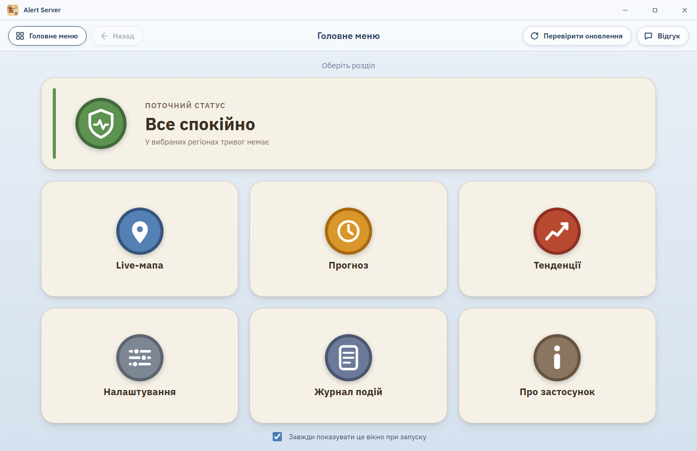
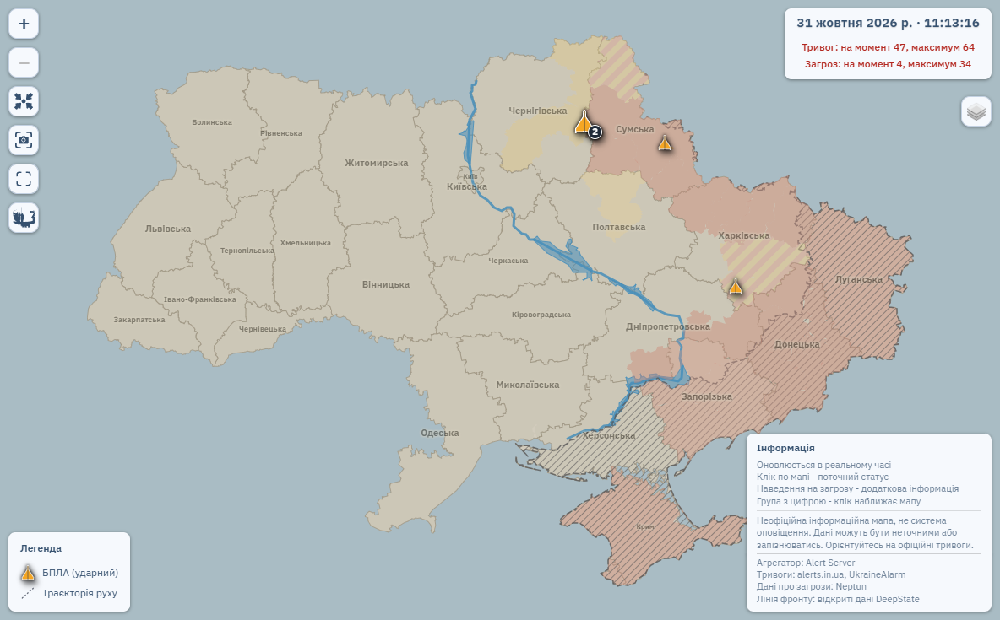
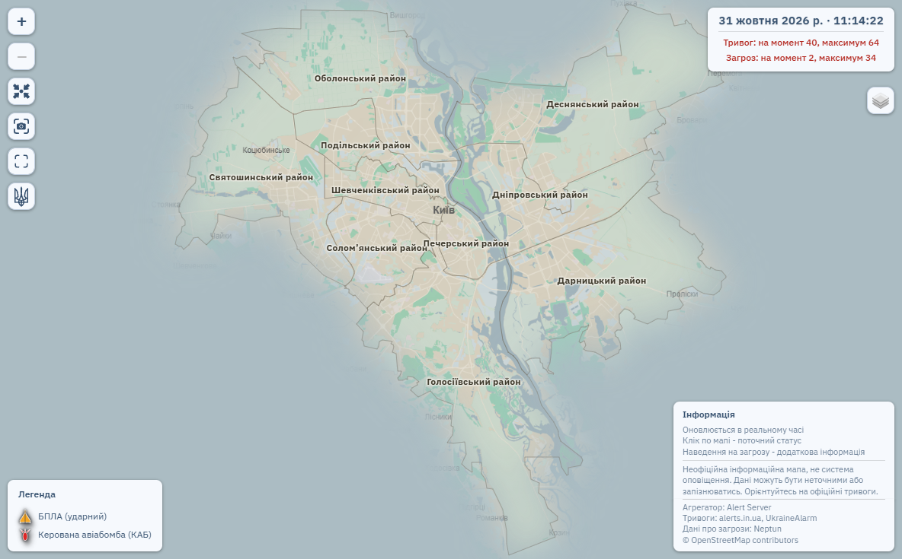
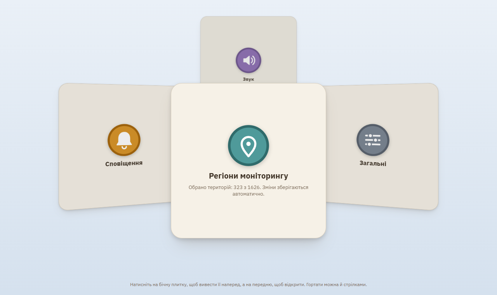
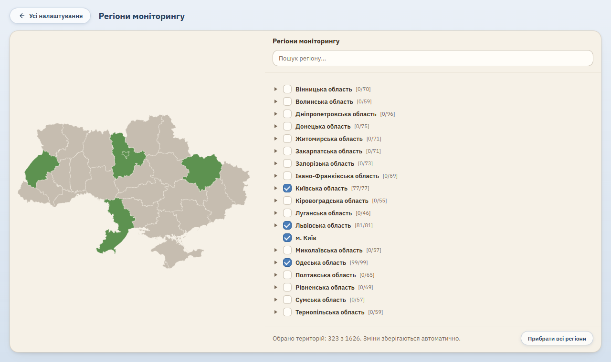
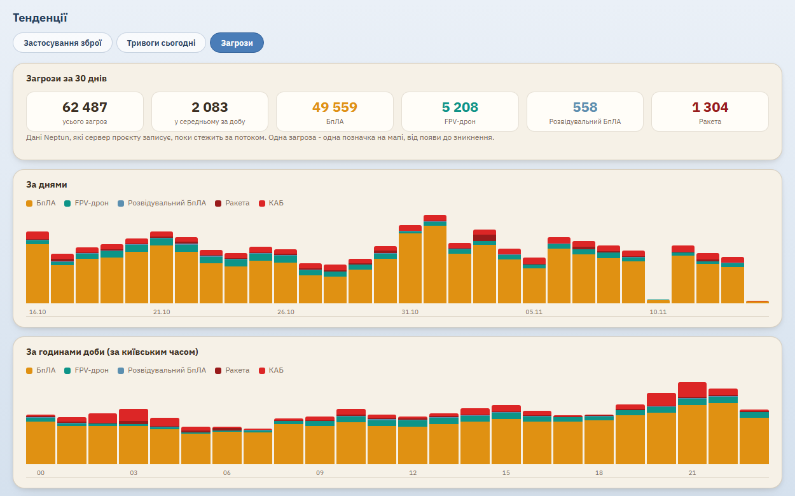
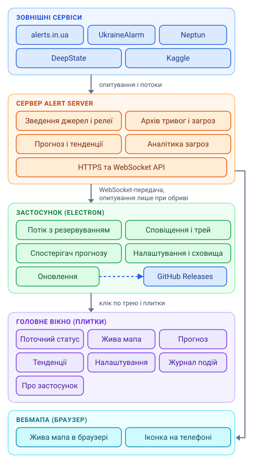

#  Alert Server

> **Дисклеймер. Повномасштабна війна країни-агресора проти України триває, починаючи з лютого 2014 року та ескалації 24 лютого 2022 року. Вся територія України залишається зоною бойових дій та потенційної ракетної загрози. Зберігайте пильність, не ігноруйте сигнали повітряної тривоги та дотримуйтесь правил безпеки.**

Застосунок для Windows, який стежить за повітряними тривогами по Україні замість вас. Він звіряє три джерела - [alerts.in.ua](https://alerts.in.ua/), [UkraineAlarm](https://www.ukrainealarm.com/) і [Neptun](https://neptun.in.ua), тож поганий день в одного з них не залишає вас у темряві, і повідомляє те, що важливо для обраних вами регіонів: сповіщення, живу мапу загроз, прогноз і трохи статистики. Живе в треї, не заважає і озивається, коли треба.

<picture>
  <source media="(prefers-color-scheme: dark)" srcset="docs/images/main-window-uk-dark.png">
  
</picture>

## Що він уміє

- **Сповіщення.** Тривога починається чи закінчується у ваших регіонах, змінюється її рівень, або прогноз каже, що вона близько: ви отримуєте сповіщення Windows з маленькою мапою, за бажанням сирену чи голос, а подробиці одним кліком. Багато тривог одразу приходять одним зведеним сповіщенням, а не потоком. Екстрені сповіщення можуть навіть пробити режим "Не турбувати" (Windows просить дозволити це один раз).
- **Жива мапа.** Тривоги по областях і районах, дрони та ракети від Neptun, лінія фронту та детальний Київ з десятьма районами. Працює і в будь-якому браузері, на телефоні теж.
- **Прогноз.** Для кожного вашого регіону: скільки вже триває поточна тривога, скільки зазвичай тривають такі, і яка ймовірність наступної найближчими годинами. Це статистика, а не кришталева куля - дивіться [методологію](docs/forecast-methodology-uk.md).
- **Тенденції.** Загальна статистика застосування зброї, тривоги сьогодні по годинах доби і те, які загрози де з'являлись.
- **Іконка в треї.** Зелена, коли тихо, набуває кольору рівня тривоги, коли ні, і стає сірою, якщо дані перестали надходити, щоб мовчазний застосунок ніколи не виглядав як спокійний.

## Використання

Клацніть лівою кнопкою по іконці в треї, і відкриється **Поточний статус**: плитка для кожного вашого регіону, і спокійних теж. Головне вікно за ним - це меню плиток: статус, жива мапа, прогноз, тенденції, налаштування, журнал подій і про застосунок, а звичний хрестик ховає вікно в трей (налаштування вирішує, чи виходити натомість).

**Жива мапа** показує все одразу, а кнопка **Київ** перемикає її на детальний вигляд столиці, де кожен район зафарбований власним рівнем тривоги.

<picture>
  <source media="(prefers-color-scheme: dark)" srcset="docs/images/live-map-uk-dark.png">
  
</picture>

<picture>
  <source media="(prefers-color-scheme: dark)" srcset="docs/images/live-map-kyiv-uk-dark.png">
  
</picture>

**Налаштування** - це карусель із чотирьох плиток: регіони для стеження (обирайте їх на мапі або в дереві з пошуком - одна позначка на регіоні покриває все всередині), загальні параметри, звук (сирена чи голос, кількість повторів, гучність, приглушення інших звуків на час сигналу і кнопка перевірки) та сповіщення, зокрема скільки кожен вид висить на екрані і чи є він екстреним.

<picture>
  <source media="(prefers-color-scheme: dark)" srcset="docs/images/settings-carousel-uk-dark.png">
  
</picture>

<picture>
  <source media="(prefers-color-scheme: dark)" srcset="docs/images/settings-window-uk-dark.png">
  
</picture>

**Тенденції** мають три вкладки: застосування зброї (з відкритого набору даних, див. [Джерела даних та атрибуції](#джерела-даних-та-атрибуції)), тривоги сьогодні з 24-годинним циферблатом і загрози, які бачив Neptun за останні 90 днів.

<picture>
  <source media="(prefers-color-scheme: dark)" srcset="docs/images/trends-uk-dark.png">
  
</picture>

Вікно **Прогнозу**, **Журнал подій** (кожен запуск, вихід, тривога, сон і перепідключення, завжди англійською) та **Про застосунок** (з формою відгуку, якщо щось не влаштовує) доповнюють набір.

## Як це працює

Застосунок не звертається до сервісів тривог сам. Він спілкується з невеликим власним сервером, який виконує важку роботу один раз для всіх:

- **Один наглядач замість трьох на кожного.** Сервер стежить за всіма трьома джерелами, зводить їх в одну картину і розсилає кожну зміну застосункам через WebSocket. Джерело, що замовкло, заморожується, а не сприймається як відбій, тож збій у джерелі ніколи не стає хибним "тривогу скасовано". Якщо недоступний сам сервер, застосунок переходить на Neptun напряму і повертається, щойно сервер відповість.
- **Спільний архів.** Кожна тривога й загроза, яку бачить сервер, зберігається (з щоденними резервними копіями), а прогноз, статистика та шар окупованих територій рахуються там. Тому свіжа інсталяція має повну історію і прогноз з першої хвилини.
- **Приватність.** Користувачів рахують за випадковим ідентифікатором інсталяції, не прив'язаним ні до людини, ні до пристрою, і зберігається лише його хеш разом з версією застосунку та країною. IP-адреси не зберігаються, вони недовго живуть у пам'яті лише для обмеження частоти запитів.

## Вебмапа

Немає під рукою Windows? Та сама жива мапа працює в будь-якому браузері, на телефоні теж: **[alert-proxy-ua.duckdns.org/live](https://alert-proxy-ua.duckdns.org/live/)**. Нічого встановлювати, жодного акаунта, жодних кукі й трекерів.

- На iOS, iPadOS та Android її можна додати на головний екран, і вона запускатиметься на весь екран як застосунок.
- Українська й англійська, світла, темна або автоматична тема, які запам'ятовуються лише у вашому браузері.
- Це неофіційне джерело, воно може запізнюватись або бути неповним, тож завжди дотримуйтесь офіційних сигналів тривоги.

Її код лежить у [web-map/](web-map/) і використовує код мапи десктопного застосунку.

## Встановлення

Завантажте свіжий `Alert Server Setup x.x.x.exe` зі сторінки [Releases](https://github.com/sergeiown/Alert_Server/releases) і запустіть. Це звичайний інсталятор для поточного користувача: без прав адміністратора, з ярликом у меню "Пуск" і деінсталятором.

Далі оновлення дбають про себе самі. Застосунок перевіряє нову версію після запуску, а потім щогодини (налаштовується), показує, що змінилось, і питає, оновлюватись зараз чи пізніше, та ніколи не відволікає, поки у вашому регіоні триває тривога. Іноді оновлення позначають обов'язковим, наприклад коли від нього залежить сервер. Тривоги працюють увесь час.

## Джерела даних та атрибуції

Самі дані про поточні тривоги надходять із трьох джерел, які зводить власний сервер проєкту й доставляє через постійне WebSocket-з'єднання: [alerts.in.ua](https://alerts.in.ua/) (опитується з дозволеною його API частотою) і [UkraineAlarm](https://www.ukrainealarm.com/) (вебхук плюс регулярні знімки, які також несуть рівень небезпеки й опис загрози) - обидва через цей сервер, плюс Neptun нижче. Крім того:

- **[Neptun](https://neptun.in.ua)** - трекінг загроз у реальному часі (дрони, ракети) на Live-мапі, завжди, а також третє з джерел поточних тривог (рівні небезпеки і підміна, якщо два попередні перестають відповідати). Ретранслюється сервером проєкту, щоб одне з'єднання обслуговувало всіх, із прямим підключенням як запасним варіантом; його [умови API](https://neptun.in.ua/api-terms) дозволяють безкоштовне комерційне й некомерційне використання та просять видиме посилання на NEPTUN поруч із даними; мапа показує його в застосунку, а тут воно наведене також.
- **[DeepState](https://deepstatemap.live/)** - лінія фронту на Live-мапі, дзеркалиться щодня через [cyterat/deepstate-map-data](https://github.com/cyterat/deepstate-map-data) (GPL-3.0). Завантажується й кешується сервером проєкту як живий потік даних, а не як вбудований код. [Ліцензійна угода](https://deepstatemap.live/license.html) DeepStateMap.live дозволяє вільно використовувати їхні візуальні й текстові матеріали з посиланням на джерело (наведено в застосунку і тут), а їхнє API лишає для волонтерських і оборонних проєктів. Цей проєкт до API не торкається: він читає відкрите дзеркало на GitHub, а якщо дзеркало зникне, шар просто зникне. Сервер піднімає попередження, коли дзеркало перестає оновлюватись.
- **[Natural Earth](https://www.naturalearthdata.com/)** (через дзеркало [nvkelso/natural-earth-vector](https://github.com/nvkelso/natural-earth-vector)) - контур річки Дніпро на Live-мапі. Суспільне надбання (public domain), атрибуція не вимагається.
- **[OpenStreetMap](https://www.openstreetmap.org/copyright)** (через збірки [Protomaps](https://protomaps.com/), відмальовка [protomaps-leaflet](https://github.com/protomaps/protomaps-leaflet)) - мапа вулиць для наближеного вигляду Києва на Live-мапі та для вуличної деталізації, що з'являється при наближенні до загрози чи регіону (масштаб 9 і ближче), у застосунку й у вебмапі. **Дані під ліцензією [ODbL](https://opendatacommons.org/licenses/odbl/) - атрибуція обов'язкова**, вказана на мапі й тут. Витяги по Києву та по всій країні розміщені на власному сервері проєкту, тож жоден сторонній сервіс тайлів не бачить, хто відкриває мапу. Ці витяги (`kyiv.pmtiles` і `ukraine.pmtiles`, публічно доступні для завантаження з сервера проєкту) похідні від даних OpenStreetMap, тож лишаються під ліцензією ODbL.
- **[slawomirmatuszak/ukrainian_geodata](https://github.com/slawomirmatuszak/ukrainian_geodata)** - межі областей, районів і міст/громад по всій Live-мапі. **Ліцензія [CC BY 4.0](https://creativecommons.org/licenses/by/4.0/) - атрибуція обов'язкова**, наведена тут.
- **[MapSVG](https://mapsvg.com/maps/ukraine)** - базовий контур України для мапи вибору регіонів і мініатюр у сповіщеннях. Вільне використання, включно з комерційним, атрибуція не вимагається умовами джерела.
- **[Vadimkin/ukrainian-air-raid-sirens-dataset](https://github.com/Vadimkin/ukrainian-air-raid-sirens-dataset)** (MIT) - кілька років реальної загальнонаціональної історії сирен, використано для калібрування довгострокового базового рівня моделі прогнозу (див. [методологію прогнозування](docs/forecast-methodology-uk.md)) і одноразово імпортовано на рівні областей в архів тривог сервера, тож загальні лічильники в прогнозі сягають лютого 2022 року. Не входить до застосунку і не завантажується під час роботи.
- **["Massive Missile Attacks on Ukraine"](https://www.kaggle.com/datasets/piterfm/massive-missile-attacks-on-ukraine) від Petro Ivaniuk (piterfm), через Kaggle** - дані для вікна "Тенденції", автоматично оновлюються через сервер проєкту (облікові дані Kaggle ніколи його не залишають). **Ліцензія [CC BY-NC-SA 4.0](https://creativecommons.org/licenses/by-nc-sa/4.0/)**: обов'язкова атрибуція, **лише некомерційне використання**, і поширення на тих самих умовах (вікно "Тенденції" технічно є похідним поданням цих даних). Цей застосунок безкоштовний і некомерційний, що задовольняє умову NC, але це реальне обмеження, про яке варто знати. Також варто зазначити: станом на момент написання, першоджерело датасету (публічні звіти Повітряних сил ЗСУ) припинило публікувати нові цифри з 10 серпня 2026 року, тож автоматичне оновлення може не показувати нових даних понад цю дату, доки (і якщо) це не зміниться. Датасет позначає такі рядки (`status_data`): рядки з прихованими або лише оціночними числами не входять у підсумки, а вікно "Тенденції" показує, скільки їх пропущено.
- **[DB-IP](https://db-ip.com)** - безкоштовна база відповідності IP країнам, яку сервер використовує для анонімної статистики використання за країнами (IP Geolocation by DB-IP). **Ліцензія [CC BY 4.0](https://creativecommons.org/licenses/by/4.0/) - атрибуція обов'язкова**, наведена тут.
- **Вбудовані бібліотеки** (Leaflet, protomaps-leaflet і пакети, на яких вони стоять) - копірайти й тексти ліцензій наведено в [THIRD_PARTY_NOTICES.md](THIRD_PARTY_NOTICES.md).
- **[Leaflet](https://leafletjs.com/)** (BSD-2-Clause) - основа Live-мапи, разом із [кнопкою повноекранного режиму](https://github.com/sergeiown/Leaflet_FullScreen_Button) - моїм давнішим проєктом плагіна саме для Leaflet, який чудово прийшовся тут до нагоди.
- **[IBM Plex](https://www.ibm.com/plex/)** (Sans і Mono, [SIL Open Font License 1.1](electron-app/src/renderer/shared/fonts/OFL.txt)) - шрифт усього інтерфейсу: Plex Sans у кожному вікні застосунку та у веб-мапі (разом із підписами вулиць на мапі), Plex Mono в журналі подій. Файли шрифтів ідуть разом із застосунком і з веб-мапою, тож жоден сторонній шрифтовий сервіс не бачить, хто її відкриває. Системний шрифт лишається лише у рідних елементах Windows (меню в треї, системні сповіщення), бо Windows не дає застосункам їх змінювати.

## Видалення

Використайте пункт `Alert Server` у Параметрах Windows → Додатки, або ярлик деінсталятора поруч із ярликом у меню Пуск.

## Внесок

Якщо у вас є пропозиції або бажання запропонувати покращення до проєкту, будь ласка, відкривайте Pull Request.

## Ліцензія

[Copyright (c) 2024-2026 Serhii I. Myshko](https://github.com/sergeiown/Alert_Server/blob/main/LICENSE) - Ліцензія MIT

Ліцензія MIT поширюється лише на код цього проєкту. Дані та сторонні матеріали, які він показує, мають власні ліцензії й умови, наведені вище біля кожного джерела (наприклад, дані розділу «Тренди» дозволено використовувати лише некомерційно), тож перевіряйте їх, перш ніж повторно використовувати або поширювати щось, окрім коду.
