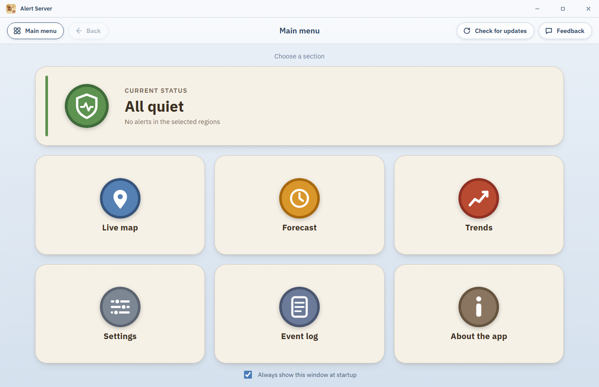
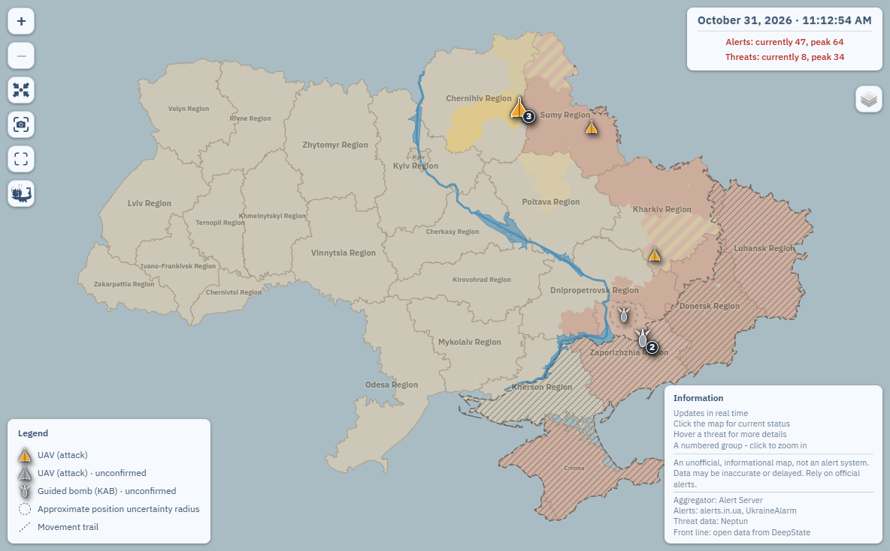
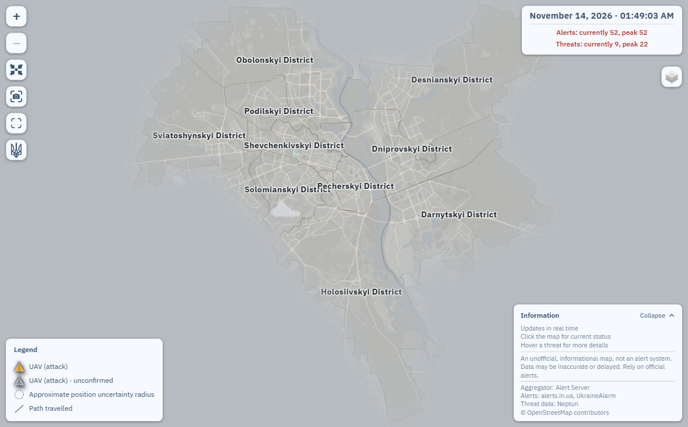
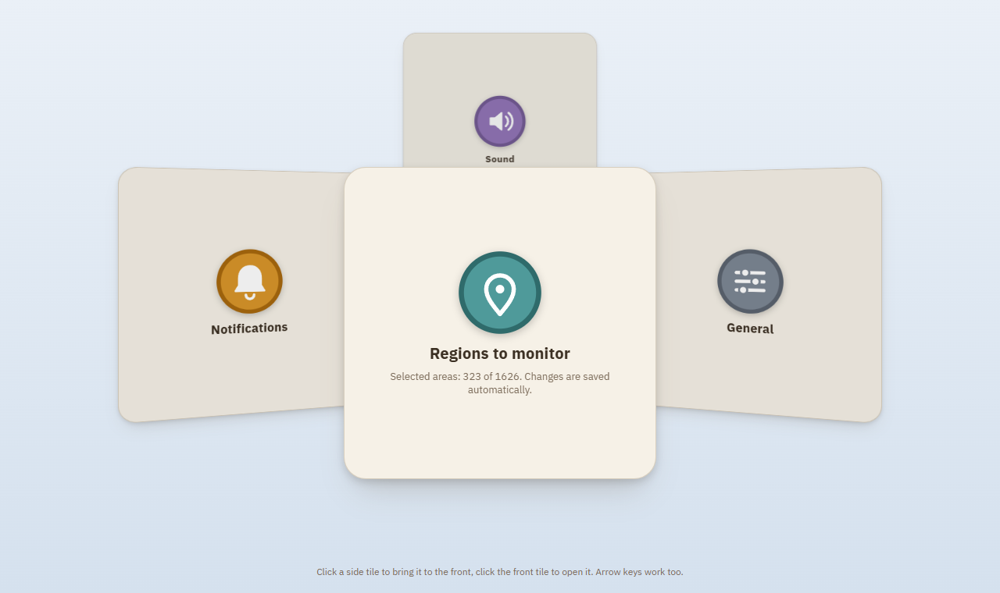
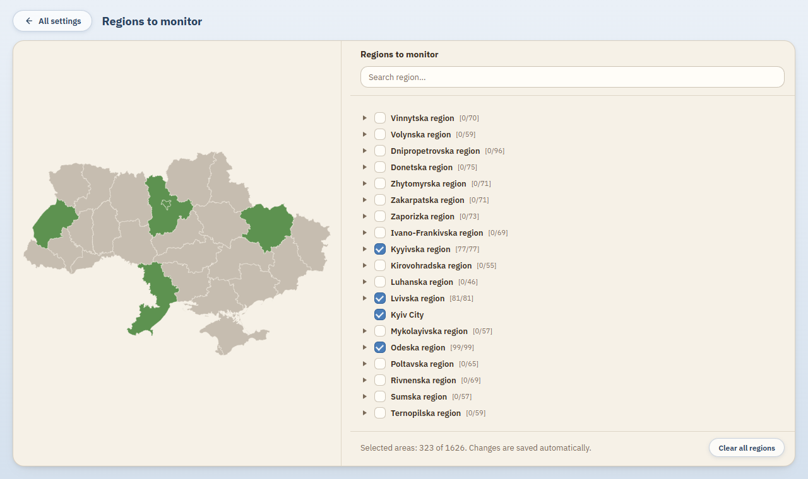
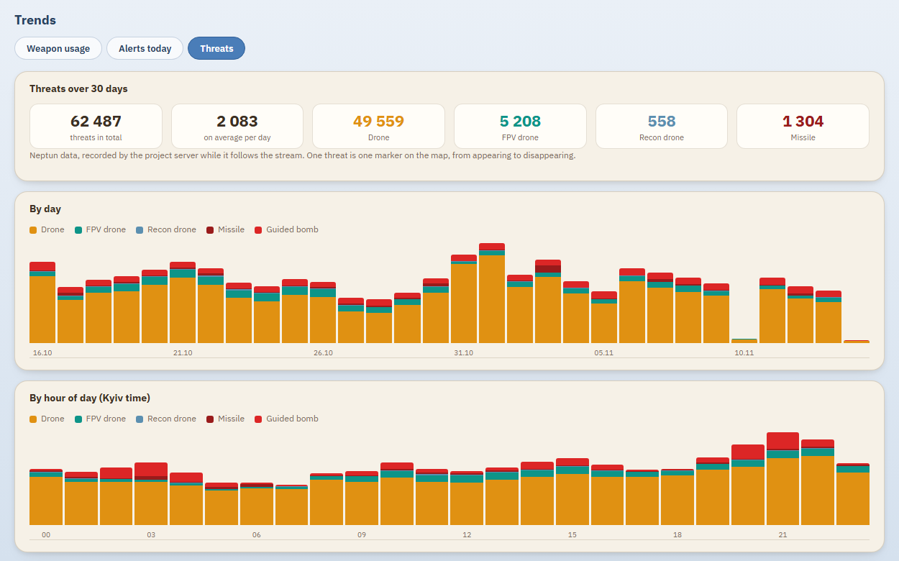
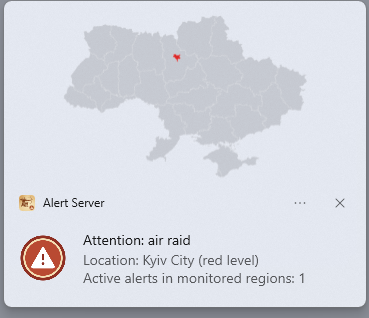
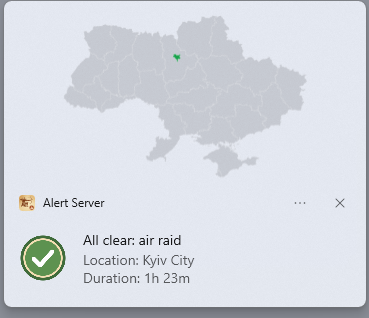
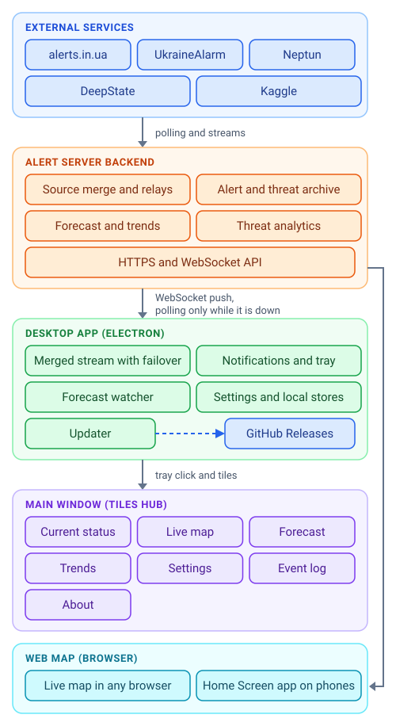

#  Alert Server

> **Disclaimer. The aggressor state's full-scale war against Ukraine has been ongoing since February 2014 and escalated into a full invasion on February 24, 2022. The entire territory of Ukraine remains a zone of active hostilities and potential missile threat. Stay vigilant, never ignore air raid alerts, and follow safety guidelines.**

A Windows app that keeps an eye on air-raid alerts across Ukraine so you don't have to. It cross-checks three sources - [alerts.in.ua](https://alerts.in.ua/), [UkraineAlarm](https://www.ukrainealarm.com/) and [Neptun](https://neptun.in.ua) - so one of them having a bad day doesn't leave you in the dark, and it tells you what matters for the regions you pick: a notification, a live threat map, a forecast and a bit of statistics. It lives in the tray, stays out of your way and speaks up when it should.

<picture>
  <source media="(prefers-color-scheme: dark)" srcset="docs/images/main-window-en-dark.png">
  
</picture>

## What it does

- **Notifications.** An alert starts or ends in your regions, its level changes, or the forecast says one is near: you get a Windows notification with a small map, an optional siren or voice, and the details one click away. Many alerts at once arrive as a single summary instead of a flood. Emergency-style notifications can even break through Do Not Disturb (Windows asks you to allow that once).
- **Live map.** Alerts by region and district, drones and missiles from Neptun, the front line, and a close-up of Kyiv's ten districts. It also runs in any browser, on a phone too.
- **Forecast.** For each of your regions: how long the current alert has lasted, how long such alerts usually last, and the odds of the next one in the coming hours. Statistics, not a crystal ball - see the [methodology](docs/forecast-methodology-en.md).
- **Trends.** Nationwide weapon-usage numbers, today's alerts by hour of the day, and what threats showed up where.
- **Tray icon.** Green when it is calm, takes the color of the alert's level when it is not, and turns grey if data stops arriving, so a silent app never looks like a calm one.

## Using it

Left-click the tray icon to open **Current status**: a tile for every region you monitor, calm ones included. The main window behind it is a menu of tiles - status, live map, forecast, trends, settings, event log and about - and the usual close cross sends it to the tray (a setting decides whether it quits instead).

The **Live map** shows everything at once; the **Kyiv** button switches it to a street-level view of the capital with each district shaded by its own alert level.

<picture>
  <source media="(prefers-color-scheme: dark)" srcset="docs/images/live-map-en-dark.png">
  
</picture>

<picture>
  <source media="(prefers-color-scheme: dark)" srcset="docs/images/live-map-kyiv-en-dark.png">
  
</picture>

**Settings** is a carousel of four tiles: the regions to monitor (pick them on the map or in a searchable tree - one tick on a region covers everything inside it), general options, sound (siren or voice, how many repeats, volume, quieting other apps while it plays, and a test button) and notifications, including how long each kind stays on screen and whether it is an emergency one.

<picture>
  <source media="(prefers-color-scheme: dark)" srcset="docs/images/settings-carousel-en-dark.png">
  
</picture>

<picture>
  <source media="(prefers-color-scheme: dark)" srcset="docs/images/settings-window-en-dark.png">
  
</picture>

**Trends** has three tabs: weapon usage (from a public dataset, see [Data sources & credits](#data-sources--credits)), alerts today with a 24-hour dial, and threats seen by Neptun over the last 90 days.

<picture>
  <source media="(prefers-color-scheme: dark)" srcset="docs/images/trends-en-dark.png">
  
</picture>

A notification looks like this: the affected region on a small map, colored by the alert's level, with the threat named when it is known, and a green one when the alert is over, with how long it lasted. Click it for the location, level, start time and a button to open the map.

<picture>
  <source media="(prefers-color-scheme: dark)" srcset="docs/images/alert-en-dark.png">
  
</picture>

<picture>
  <source media="(prefers-color-scheme: dark)" srcset="docs/images/cancel-en-dark.png">
  
</picture>

The **Forecast** window, the **Event log** (every start, exit, alert, sleep and reconnect, always written in English) and **About** (with a feedback form, in case something bothers you) complete the set.

## How it works

The app doesn't talk to the alert services itself. It talks to a small self-hosted server that does the heavy lifting once for everyone:

- **One watcher instead of three per user.** The server follows all three sources, merges them into a single picture and pushes every change to the apps over a WebSocket. A source that goes quiet is frozen rather than read as an all-clear, so an upstream hiccup never turns into a false "alert cancelled". If the server itself is unreachable, the app switches to Neptun directly and comes back as soon as the server answers.
- **A shared archive.** Every alert and threat the server sees is stored (with daily backups), and the forecast, the statistics and the occupied-territory layer are computed there. That is why a fresh install has a full history and a forecast from the first minute.
- **Privacy.** Users are counted by a random installation ID that is tied to neither a person nor a device, and only its hash is stored, with the app version and the country. IP addresses are not stored; they live briefly in memory to limit request rates.

## Web map

No Windows machine at hand? The same live map runs in any browser, on a phone too: **[alert-proxy-ua.duckdns.org/live](https://alert-proxy-ua.duckdns.org/live/)**. Nothing to install, no account, no cookies, no trackers.

- On iOS, iPadOS and Android you can add it to the Home Screen and it launches full screen like an app.
- Ukrainian and English, light, dark or automatic theme, remembered in your own browser only.
- It is an unofficial source and can lag behind or be incomplete, so always follow the official alert signals.

Its source lives in [web-map/](web-map/) and reuses the desktop app's map code.

## Installation

Download the latest `Alert Server Setup x.x.x.exe` from [Releases](https://github.com/sergeiown/Alert_Server/releases) and run it. It is a standard per-user installer: no administrator rights, a Start Menu shortcut and an uninstaller included.

After that, updates take care of themselves. The app checks for a new version after launch and then every hour (adjustable in Settings), shows what changed and asks whether to update now or later, and never interrupts you while an alert is active in one of your regions. Now and then an update is marked as mandatory, for example when the server depends on it. Alerts keep working throughout.

## Data sources & credits

The current-alerts data comes from three feeds merged on the project's own server and delivered over a persistent WebSocket connection - [alerts.in.ua](https://alerts.in.ua/) (polled at the pace its API allows) and [UkraineAlarm](https://www.ukrainealarm.com/) (a webhook plus regular snapshots, which also carry the severity level and threat description), both used through that server, plus Neptun below. Beyond that:

- **[Neptun](https://neptun.in.ua)** - live threat tracking (drones, missiles) shown on the Live map, always, and also the third of the current-alerts feeds (severity levels, and a stand-in if the two above stop responding). Relayed by the project's server so that a single connection serves everyone, with a direct connection as a fallback; its [API terms](https://neptun.in.ua/api-terms) allow free commercial and non-commercial use and ask for a visible link to NEPTUN next to the data, which the map shows in-app and which is given here too.
- **[DeepState](https://deepstatemap.live/)** - the front line shown on the Live map, mirrored daily via [cyterat/deepstate-map-data](https://github.com/cyterat/deepstate-map-data) (GPL-3.0). Fetched and cached by the project's server as a live data feed, not bundled code. The DeepStateMap.live [license agreement](https://deepstatemap.live/license-en.html) lets anyone reuse its visual and text materials with a link back (given in-app and here) and keeps its API for volunteer and defence projects. This project does not touch that API: it reads the public GitHub mirror, and if the mirror ever goes away the layer simply disappears. The server raises a warning when the mirror stops updating.
- **[Natural Earth](https://www.naturalearthdata.com/)** (via the [nvkelso/natural-earth-vector](https://github.com/nvkelso/natural-earth-vector) mirror) - the Dnipro river outline on the Live map. Public domain, no attribution required.
- **[OpenStreetMap](https://www.openstreetmap.org/copyright)** (via [Protomaps](https://protomaps.com/) basemap builds, rendered with [protomaps-leaflet](https://github.com/protomaps/protomaps-leaflet)) - the street map for the Live map's Kyiv close-up view and for the street-level detail that appears when you zoom in on a threat or a region (zoom 9 and closer), in the app and in the web map. **Data licensed [ODbL](https://opendatacommons.org/licenses/odbl/) - attribution required**, shown on the map and given here. Extracts of Kyiv and of the whole country are hosted on the project's own server, so no third-party tile service ever sees who opens the map. Those extracts (`kyiv.pmtiles` and `ukraine.pmtiles`, publicly downloadable from the project server) are derived from OpenStreetMap data, so they stay under ODbL as well.
- **[slawomirmatuszak/ukrainian_geodata](https://github.com/slawomirmatuszak/ukrainian_geodata)** - region, district, and city/community boundaries used throughout the Live map. **Licensed [CC BY 4.0](https://creativecommons.org/licenses/by/4.0/) - attribution required**, given here.
- **[MapSVG](https://mapsvg.com/maps/ukraine)** - the base Ukraine outline used for the region-picker map and notification thumbnails. Free to use, including commercially, no attribution required by its own terms.
- **[Vadimkin/ukrainian-air-raid-sirens-dataset](https://github.com/Vadimkin/ukrainian-air-raid-sirens-dataset)** (MIT) - several years of real nationwide siren history, used to calibrate the forecast model's long-horizon baseline (see [forecast methodology](docs/forecast-methodology-en.md)) and imported once, at oblast level, into the server's alert archive, so the all-time counters in the Forecast reach back to February 2022. Not bundled with the app, not fetched at runtime.
- **["Massive Missile Attacks on Ukraine"](https://www.kaggle.com/datasets/piterfm/massive-missile-attacks-on-ukraine) by Petro Ivaniuk (piterfm), via Kaggle** - the data behind the Trends window, refreshed automatically through the project's server (the Kaggle credentials never leave it). **Licensed [CC BY-NC-SA 4.0](https://creativecommons.org/licenses/by-nc-sa/4.0/)**: attribution required, **non-commercial use only**, and share-alike (the Trends window is effectively a derivative presentation of this data). This app is free and non-commercial, which satisfies the NC term, but it's a real constraint worth knowing about. Also worth noting: as of this writing, the dataset's own upstream source (Ukrainian Air Force public reporting) stopped publishing new figures on August 10, 2026, so the automatic refresh may not surface new data past that date until/unless that changes. The dataset marks such rows (`status_data`): rows with hidden or merely inferred counts are left out of the totals, and the Trends window says how many were skipped.
- **[DB-IP](https://db-ip.com)** - the free IP-to-country database the backend uses for anonymous per-country usage statistics (IP Geolocation by DB-IP). **Licensed [CC BY 4.0](https://creativecommons.org/licenses/by/4.0/) - attribution required**, given here.
- **Bundled libraries** (Leaflet, protomaps-leaflet and the packages they build on) - copyright notices and license texts are reproduced in [THIRD_PARTY_NOTICES.md](THIRD_PARTY_NOTICES.md).
- **[Leaflet](https://leafletjs.com/)** (BSD-2-Clause) powers the Live map, together with a [fullscreen control](https://github.com/sergeiown/Leaflet_FullScreen_Button) - an earlier plugin project of mine for Leaflet that turned out to fit right in here.
- **[IBM Plex](https://www.ibm.com/plex/)** (Sans and Mono, [SIL Open Font License 1.1](electron-app/src/renderer/shared/fonts/OFL.txt)) - the typeface of the whole interface: Plex Sans in every app window and in the web map (street labels on the map included), Plex Mono in the event log. The font files travel with the app and with the web map, so no third-party font service ever sees who opens it. Only the native Windows bits (tray menu, system notifications) keep the system font, because Windows does not let apps change those.

## Removal

Use the `Alert Server` entry in Windows Settings → Apps, or the uninstaller shortcut created alongside the Start Menu shortcut.

## Contribution

If you have suggestions or want to propose improvements to the project, please open a pull request.

## License

[Copyright (c) 2024-2026 Serhii I. Myshko](https://github.com/sergeiown/Alert_Server/blob/main/LICENSE) - MIT License

MIT covers the code of this project only. The data and third-party material it shows keep their own licenses and terms, listed above with each source (for example, the Trends data is non-commercial only), so check those before reusing or redistributing anything beyond the code.
